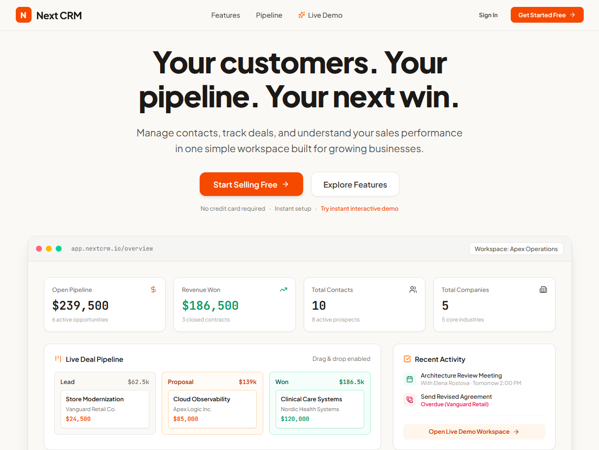
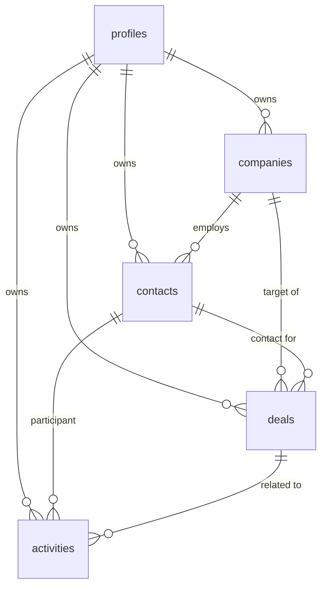

# NextCRM

> A modern, responsive CRM web application designed for small businesses, freelancers, and sales teams who want a simple, powerful way to manage customer relationships and drive their sales pipeline.

<p align="center">
  
  
  
  
  
</p>

<p align="center">
  
</p>

---
## 🌟 Overview

**Next CRM** delivers a polished, intuitive SaaS experience built around speed, clarity, and visual elegance. Designed with a warm orange palette, strict visual hierarchy, and real-time data calculations, Next CRM eliminates enterprise bloat while giving sales teams everything needed to close deals faster.

### Key Highlights
- **Real-Time Data Consistency**: Every dashboard metric, stage total, company summary, and chart updates dynamically whenever records are created, edited, dragged, or deleted.
- **Interactive Kanban Pipeline**: Drag and drop deals across 6 sequential stages (`Lead` → `Qualified` → `Proposal` → `Negotiation` → `Won` → `Lost`) with instant recalculation of column values and revenue won.
- **Dual Persistence Architecture**: Powered by **Supabase PostgreSQL** with **Row Level Security (RLS)** and client-side encrypted isolation when running locally.
- **Enterprise-Grade Data Isolation**: Strict user-level partitioning ensures team members only view and modify their own accounts, contacts, deals, and activities.

---

## 🚀 Key Features

### 1. 📊 Overview Dashboard
- **4 Real-Time KPI Cards**:
  - **Open Pipeline Value**: Total value of active deals (excluding Won and Lost).
  - **Revenue Won**: Cumulative value of closed-won contracts.
  - **Total Contacts**: Contact roster count with active vs. lead breakdown.
  - **Total Companies**: Organization count managed in the workspace.
- **Pipeline by Stage Chart**: Visual horizontal bar progression with deal counts and currency totals.
- **Contacts by Status Donut**: Visual breakdown of Active, Lead, and Inactive contacts.
- **Recent Deals Stream**: Quick access to recently updated opportunities.
- **Upcoming Activity Feed**: Chronological list of scheduled calls, meetings, tasks, and overdue items with 1-click completion toggles.
- **Global Quick Add**: Fast modal access to create deals, contacts, companies, or activities from anywhere.

### 2. 📇 Contact Management
- Searchable and filterable address book by name, email, phone, or associated company.
- Status filters (`All`, `Active`, `Lead`, `Inactive`) with sortable table columns.
- Initials avatars with clear visual hierarchy.
- **Contact Dossier View**: View associated organization, linked deals with values, and interaction history.
- Safe relationship dissociation—deleting a contact never silently deletes deals or tasks.

### 3. 🏢 Company Management
- Responsive switch between **Card Grid** and **Table View**.
- Live calculated metrics: Associated contact count and total open pipeline value per company.
- Clickable external website links, phone numbers, and location tags.
- Detailed company modal with all team contacts and active deal opportunities.

### 4. 🎯 Deals & Sales Pipeline
- **Interactive Kanban Board**: 6 exact pipeline stages:
  1. `Lead` — Initial outreach and inquiry
  2. `Qualified` — Verified budget and need
  3. `Proposal` — Formal quote and scope submitted
  4. `Negotiation` — Legal and commercial terms review
  5. `Won` — Contract signed and invoiced
  6. `Lost` — Closed lost with reason tracking
- **HTML5 Drag-and-Drop**: Smooth card dragging between columns that automatically updates stages and re-tallies column totals.
- **Accessible Alternative**: In-card stage dropdown switcher for non-mouse or keyboard users.
- **Table / List View**: Sort opportunities by deal value, close target, priority, or creation date.
- **Deal Detail Stepper**: Visual stage progression stepper with activity logging.

### 5. 📅 Activities & Task Tracking
- Activity timeline supporting 5 distinct touchpoint types:
  - 📞 **Call**
  - ✉️ **Email**
  - 📅 **Meeting**
  - 📝 **Note**
  - ☑️ **Task**
- Filter by status (`All`, `Open`, `Overdue`, `Completed`) and activity type.
- **Overdue Detection**: Automatically highlights past-due tasks in red with urgency alerts.
- 1-click completion checkbox with immediate state persistence.

### 6. 📈 Sales Analytics
- **Pipeline by Stage**: Distribution of open deal values and deal counts.
- **Deal Outcomes Donut**: Win/loss ratio and closed conversion percentage.
- **Sales Funnel Progression**: Horizontal step drop-off from Lead to Won with step conversion metrics.
- **Industry Breakdown**: Categorization of accounts and contacts across market verticals.
- **Key Financial Metrics**: Average Won Deal Value, Average Open Deal Value, and Win Rate.
- Account-specific filtering for granular analysis.

---

## 🎨 Design System

Next CRM adheres to a bespoke SaaS visual language:

| Token | Value / Tailwind | Purpose |
| :--- | :--- | :--- |
| **Primary** | `#F97316` (`orange-500`) | Primary actions, stage highlights, active navigation |
| **Primary Hover** | `#EA580C` (`orange-600`) | Hover and active interaction states |
| **Secondary Accent** | `#FDBA74` (`orange-300`) | Subtle borders, light highlights |
| **Canvas Background** | `#FAF9F6` | Warm off-white page background |
| **Card Surface** | `#FFFFFF` | Clean white elevated cards and panels |
| **Primary Text** | `#242424` (`stone-900`) | High-contrast headings and body prose |
| **Muted Text** | `#737373` (`stone-500`) | Secondary metadata and labels |
| **Borders** | `#E7E5E4` (`stone-200`) | Subtle hairline dividers and card borders |
| **Success** | `#10B981` (`emerald-600`) | Won stage, active statuses, completed tasks |
| **Danger / Alert** | `#E11D48` (`rose-600`) | Overdue tasks, lost deals, destructive actions |
| **Typography** | `Plus Jakarta Sans` | Modern display and body font |
| **Numerals** | `JetBrains Mono` / `tabular-nums` | Monospace alignment for currency and metrics |

---

## 🛠️ Tech Stack

- **Framework**: [React 19](https://react.dev/) + [TypeScript](https://www.typescriptlang.org/)
- **Bundler & Dev Server**: [Vite 8](https://vitejs.dev/)
- **Styling**: [Tailwind CSS v4](https://tailwindcss.com/)
- **Icons**: [Lucide React](https://lucide.dev/)
- **Animations**: [Motion](https://motion.dev/)
- **Database & Auth**: [Supabase](https://supabase.com/) (`@supabase/supabase-js`)
  - PostgreSQL Relational Database
  - Supabase Auth (Email & Password)
  - Row Level Security (RLS) Policies
- **Cryptography**: Web Crypto API (`crypto.subtle` SHA-256)

---

## 💾 Database Schema & Supabase Setup

Next CRM includes a production-ready PostgreSQL migration script located at **`supabase/schema.sql`**.

### Schema Overview



### Running the Migration in Supabase

1. Open your **[Supabase Dashboard](https://supabase.com/dashboard)**.
2. Select your project and navigate to **SQL Editor** in the left sidebar.
3. Click **New query**.
4. Open **`supabase/schema.sql`** in this repository, copy its entire contents, paste them into the editor, and click **Run**.
5. The script automatically creates:
   - `public.profiles`
   - `public.companies`
   - `public.contacts`
   - `public.deals`
   - `public.activities`
   - Performance indexes on foreign keys
   - Idempotent Row Level Security (RLS) policies enforcing `auth.uid() = user_id`
   - Auth trigger (`handle_new_user()`) for automatic profile provisioning

---

## ⚙️ Environment Variables

Create a `.env` file in the project root based on `.env.example`:

```env
# Supabase Configuration
VITE_SUPABASE_URL="https://your-project-id.supabase.co"
VITE_SUPABASE_ANON_KEY="your-anon-public-key"
```

> **Security Note:** Only use the public `anon` key in frontend code. Never expose the `service_role` secret key.

---

## 📦 Getting Started

### Prerequisites
- Node.js (v18 or newer)
- npm or bun

### Installation

1. **Clone the repository**:
   ```bash
   git clone https://github.com/your-username/next-crm.git
   cd next-crm
   ```

2. **Install dependencies**:
   ```bash
   npm install
   ```

3. **Configure environment variables**:
   ```bash
   cp .env.example .env
   # Add your VITE_SUPABASE_URL and VITE_SUPABASE_ANON_KEY
   ```

4. **Start the development server**:
   ```bash
   npm run dev
   ```
   Open [http://localhost:3000](http://localhost:3000) in your browser.

---

## 📜 Available Scripts

| Command | Description |
| :--- | :--- |
| `npm run dev` | Starts the Vite development server on port 3000 |
| `npm run build` | Compiles TypeScript and builds production assets in `dist/` |
| `npm run preview` | Previews the built application locally |
| `npm run lint` | Runs TypeScript type checking (`tsc --noEmit`) |
| `npm run clean` | Removes build artifacts (`dist`) |

---

## 🔒 Security & Data Isolation

- **Row Level Security (RLS)**: Enforced directly at the PostgreSQL layer. Users cannot query or mutate records belonging to other users, regardless of client-side requests.
- **Client Sanitization**: All form inputs are validated for email structure, positive numeric deal values, and required fields.
- **Zero Insecure Storage**: Passwords are never stored in plaintext. In offline/local modes, passwords use salted SHA-256 cryptographic hashing.

---

## 📄 License

This project is licensed under the Apache 2.0 License.
